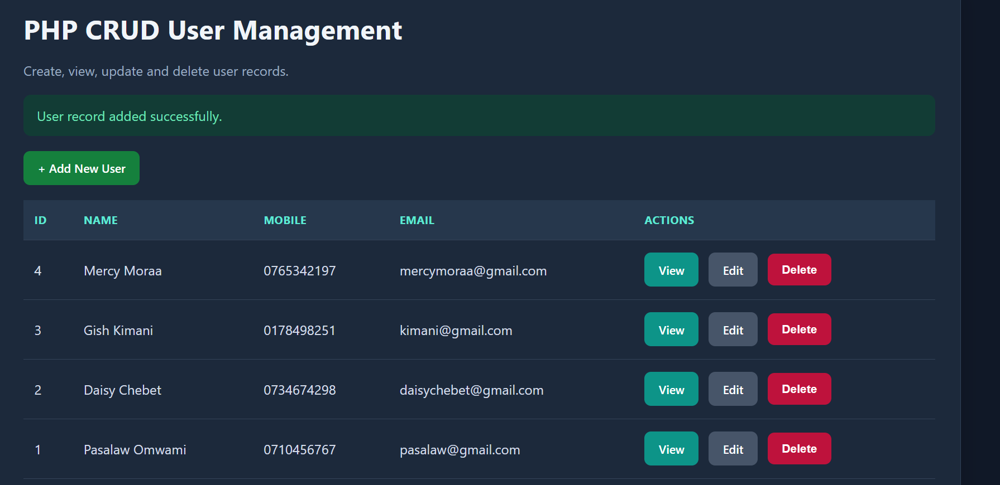
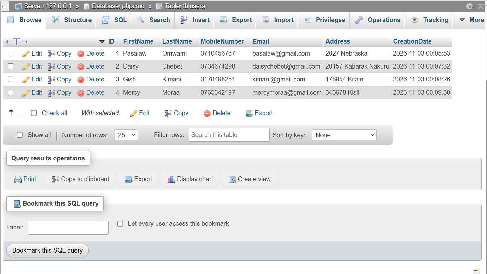

# PHP CRUD User Management System

## About the Project

This is a simple PHP and MySQL-based User Management System developed to demonstrate the four basic CRUD operations: Create, Read, Update and Delete.

The application allows users to add new records, view existing records, update user information and delete records through a web interface.

## Technologies Used

- PHP
- MySQL
- HTML
- CSS
- XAMPP
- Visual Studio Code

## Project Structure

```text
phpcrud/
│
├── screenshots/
│   ├── application-records.png
│   └── database-records.png
│
├── database.sql
├── dbconnection.php
├── delete.php
├── edit.php
├── functions.php
├── index.php
├── insert.php
├── read.php
├── README.md
└── style.css
```

## Requirements

- XAMPP (Apache and MySQL)
- A web browser
- PHP and MySQL

## Installation and Setup

1. Copy the `phpcrud` project folder into the XAMPP `htdocs` directory.
2. Open the XAMPP Control Panel.
3. Start Apache and MySQL.
4. Open `http://localhost/phpmyadmin` in your browser.
5. Select the SQL tab and import or execute the `database.sql` file.
6. Open the application using:

   `http://localhost/phpcrud/`

## Database Configuration

The application uses the following database settings:

| Setting | Value |
|---|---|
| Host | localhost |
| Username | root |
| Password | Blank |
| Database | phpcrud |

If your MySQL root account has a password, update the connection settings in `dbconnection.php`.

## CRUD Operations

The application supports the following operations:

**1. Create**

Users can add new records by filling in the registration form.

**2. Read**

Users can view all registered records on the main page and view individual records.

**3. Update**

Users can edit existing records and save the updated information.

**4. Delete**

Users can remove records from the database using the delete option.

## Screenshots

### Application Records



### Database Records



## Additional Information

- The `database.sql` file contains the database and table creation script.
- The `dbconnection.php` file handles the connection between PHP and MySQL.
- The `functions.php` file contains shared application functions.
- The `MobileNumber` field uses VARCHAR to preserve leading zeros in phone numbers.

## Author

**PASALAW NYAKUNDI**
